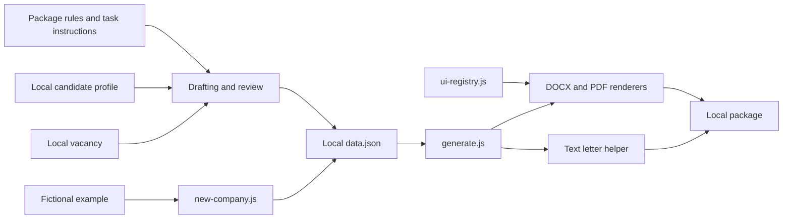

# Components and Data Flow

## Boundaries

Workflow instructions guide vacancy analysis, evidence selection, writing, ATS alignment, and review. They never supply candidate facts. CLI scripts read structured local package data and write documents beside it. A template registry supplies shared PDF and DOCX presentation settings; fictional JSON provides the structure for new packages.

Candidate profiles, vacancies, histories, photos, preparation notes, and rendered documents are local inputs and outputs, outside the repository boundary.

## Dependencies and entry points

`new-company.js` creates a folder under `src/resumes/`, copies the example structure, and adds a vacancy placeholder. `generate.js` coordinates CV DOCX/PDF generation, language-specific cover-letter PDFs, and a text helper. Cover-letter scripts also have direct CLI entry points.

Renderers depend on the registry and the existing `docx` and `puppeteer` packages. The registry does not read candidate files. Drafting instructions are independent of rendering. There is no application server, database, account system, or deployment service.

## Data contract and limitations

`templates/data.example.json` is the structural example; `docs/workflows/document-package.md` defines content rules. Template selection uses `meta.template`; optional `meta.labels` controls CV section labels. Output filenames are generic. Contact details come only from local data.

CV renderers support optional messaging contacts; cover-letter headers render location, email, phone, professional profiles, and website. The CLI checks file presence and template names, but does not fully validate content. Fact checking, consent, page count, and visual inspection remain workflow responsibilities.

PDF rendering uses a local browser. Run the CLI only with trusted local data; it is not a service for arbitrary uploaded documents. The privacy check validates tracked paths, not semantic content or commit ancestry. Publication therefore also requires content review and a clean history.
